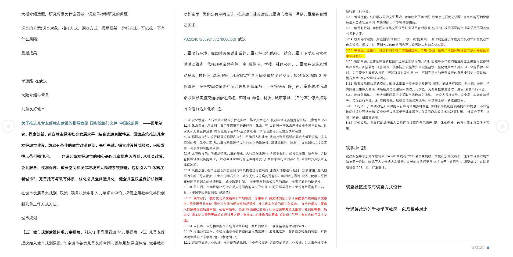
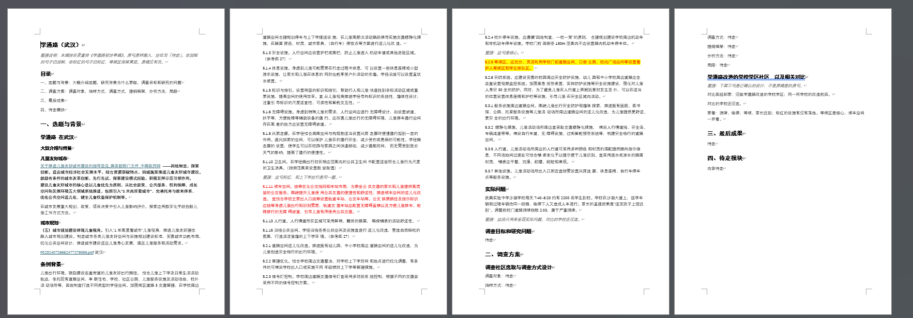

# draft-thinking-align

[中文](README.zh-CN.md)

Recover a clear thinking chain from messy drafts (bold/red/highlight/headings)—confirm first, one question at a time, never overwrite the source.

A skill for people like me who love messy brainstorms—and need help turning them into a clear thinking chain without losing their own voice.

## Who it's for

In an AI era, ideas are everything. My head is always full of scattered sparks. In high school I left them all over scraps of paper; now in college, when I work on projects, I dump everything into a doc—paste impressive snippets, paint text red, bold it, crank up the font—until the whole file is chaos that only I can read.

Fighting "AI-sounding" writing taught me something: when I hand a model a complete chain of thought, the generic AI tone drops a lot. I'm happy to pour out my ideas; what drains me is layout and gathering materials.

This skill is for creators who have a line of thinking in their head—but once it's on the page, even they can't tell what they're saying.

**Not for:** polishing a finished draft, inventing research conclusions that weren't in the source, or writing code.

## How it works

1. Read only the draft you name. Infer a rough thinking chain from content and formatting (bold, red, highlight, headings, lists, comments), then refine that chain with you—one confirmation at a time.
2. Run in-draft commands in context (for example, "pick the important bits from the pasted text below").
3. Reorganize and layout. If something still needs material, search, show sources and short excerpts, and insert only after you approve.
4. The output file contains only the original draft plus search results you approved. Gaps stay `TBD`. Always save as a new file—never overwrite the source.

### Checklist

1. Read the named file.
2. List thinking nodes (`claim | evidence | example | open | instruction | other`).
3. Stop at the confirm gate until that list is confirmed.
4. Ask intent marks one at a time (comment, red, highlight, bold, heading, list).
5. Chain the nodes; gaps stay named `TBD`.
6. Run in-draft commands only after asking.
7. Search, show the source and a short excerpt, and insert only with approval.
8. Package as one table-of-contents document or a folder split by block.
9. Save a new file. The source stays untouched.

## Install

1. Copy this folder into your Claude / Cursor skills directory (keep the directory name).
2. Restart or refresh the agent so it picks up new skills.
3. Invoke it when you want to organize a messy Word or text brainstorm—point it at one draft path.
4. Follow its one-question-at-a-time flow until it saves a new organized file.

## Example

Below is a market-research plan example from a competition this year (partially redacted). The project thinking isn't complete yet, so the last two modules are left empty—exactly the kind of draft this skill is meant to align before formatting.

For a short text walkthrough, see [examples/before-after.md](examples/before-after.md).

## Layout

- [SKILL.md](SKILL.md) — full rules
- [references/](references/) — output template and question prompts
- [examples/](examples/) — redacted text walkthrough and the screenshots above
- [README.zh-CN.md](README.zh-CN.md) — 中文

## License

[MIT](LICENSE) — Copyright 2026 JZao87.
