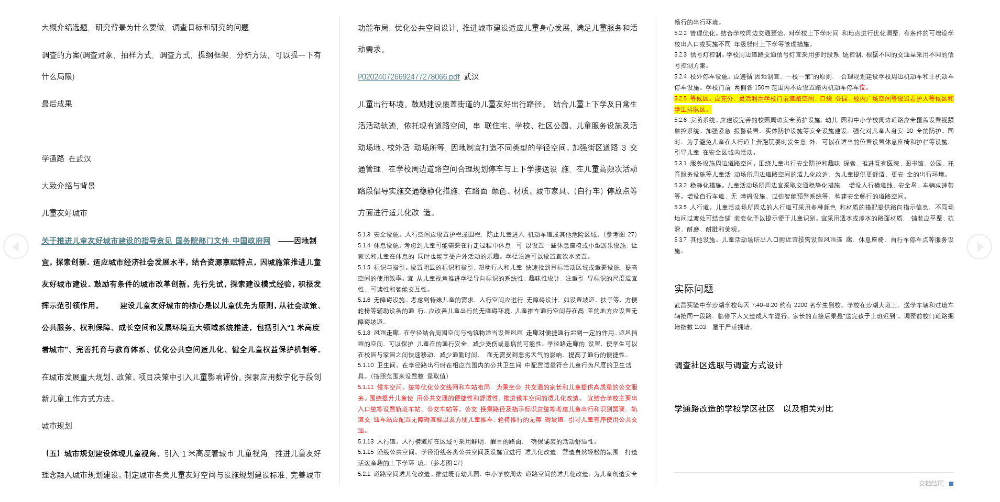
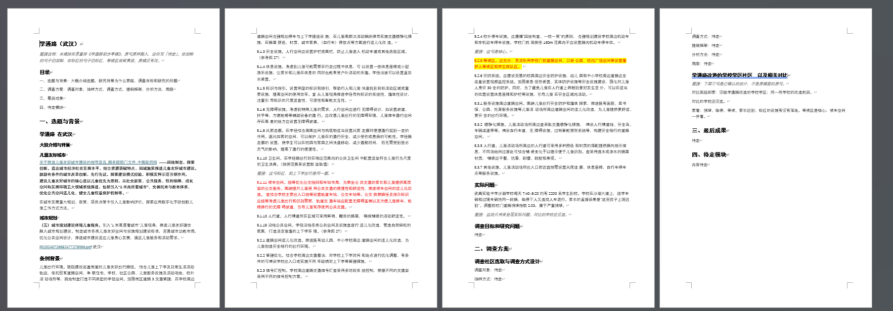

# draft-thinking-align

[English](README.md)

## 一句话

这个 skill 献给和我一样喜欢乱七八糟的头脑风暴的人。

## 给谁用

在这个 AI 时代，创意与想法是一切。我的脑子里总是有很多零散的创意。高中的时候喜欢把这些想法又零散地散落在纸上；现在上大学了，做项目时也喜欢在文档上乱写一通，不停粘贴很多很厉害的东西，标红、加粗、字体变大，结果整个文档乱七八糟的，全世界只有我自己能看懂。

另外，在长期与文本「AI 味」的斗争中我发现：当我把一个完整的思路链条交给模型时，AI 味往往会淡很多。有时候让 AI 帮我写东西，我仍很乐意输出自己的想法，只是排版、整理材料真的让人头大。

此 skill 献给和我一样——脑袋中有思路，但写到文档上就不知道在说什么的创意者们。

**不适合：** 定稿改字、撰写原稿没有的研究结论、写代码。

## 怎么工作

1. 先观察字体与内容，大致判断思维链；再结合草稿排版，并通过向用户确认来完善思维链（一次只问一件事）。
2. 草稿中的命令也会执行（例如「帮我选出下面一堆 copy 文本的重要内容」），根据上下文执行。
3. 排版并整理；查看是否有需要补充的内容；检索后经用户审核再插入。
4. 整理后文件仅含有原草稿内容，以及经检索并审核后的内容；空位写「待定」；新文件另存，不覆盖原稿。

## 安装使用

1. 把本文件夹放进 Claude / Cursor 的 skills 目录（保留文件夹名）。
2. 重启或刷新助手，让它加载新技能。
3. 需要整理乱七八糟的 Word/文稿头脑风暴时唤起它，并指定唯一一份草稿路径。
4. 按「一次一问」流程走完，最后另存整理稿。

## 示例

我这里放一个市调的方案例子（今年参赛，部分打码）。可见这里没有完整的项目思路，所以最后两个模块留空。

另见 [examples/before-after.md](examples/before-after.md)。

## 许可

[MIT](LICENSE) — Copyright 2026 JZao87。

## 完整规则

见 [SKILL.md](SKILL.md)。
